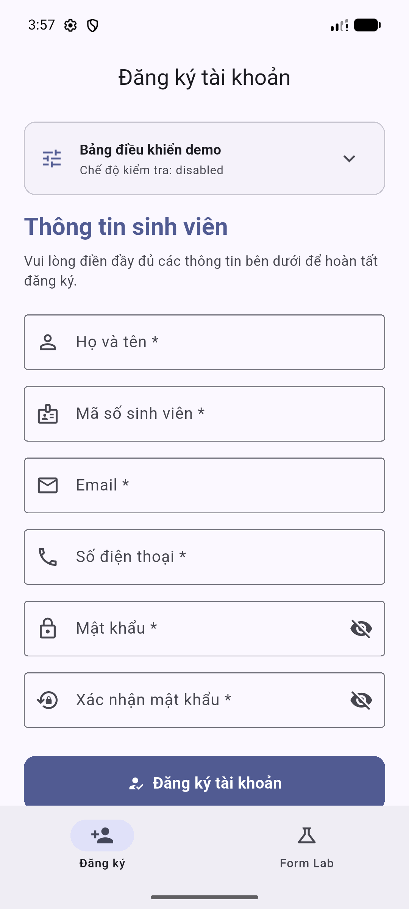
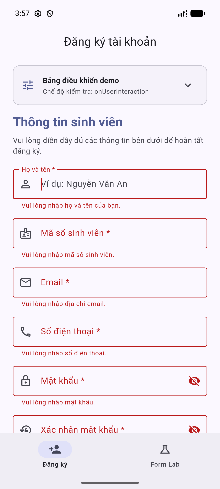
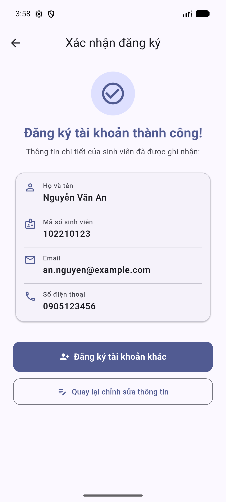
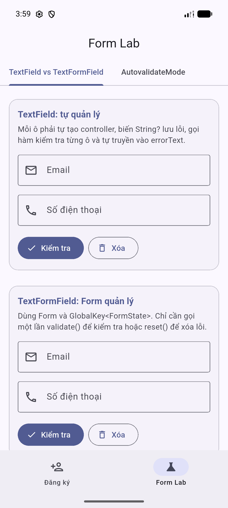

# Student Signup — Biểu mẫu và kiểm tra dữ liệu đầu vào

Dự án ứng dụng di động Flutter xây dựng biểu mẫu đăng ký thông tin sinh viên và phòng thí nghiệm khảo sát cơ chế biểu mẫu (`Form Lab`), thuộc học phần **Lập trình đa nền tảng** (Trường Đại học Bách khoa – Đại học Đà Nẵng).

## Hình ảnh minh họa giao diện

| Form đăng ký | Form báo lỗi | Màn xác nhận | Form Lab |
| :---: | :---: | :---: | :---: |
|  |  |  |  |

---

## 1. Mục tiêu theo yêu cầu chủ đề

- **Phần lý thuyết:**
  - Nắm vững kiến trúc xử lý biểu mẫu trong Flutter: cơ chế quản lý trạng thái, vòng đời của `Form` và `FormField`.
  - Phân tích sự khác biệt cốt lõi giữa `TextField` (tự quản lý thủ công) và `TextFormField` (quản lý tập trung qua `FormState`).
  - Hiểu rõ vai trò và cơ chế hoạt động của `GlobalKey<FormState>`, `TextEditingController`, `FocusNode`.
  - Khảo sát chuyên sâu 5 chế độ tự động kiểm tra của `AutovalidateMode` (`disabled`, `always`, `onUserInteraction`, `onUnfocus`, `onUserInteractionIfError`).
- **Phần thực hành & demo:**
  - Xây dựng biểu mẫu đăng ký sinh viên 6 trường với thiết kế Material 3 hiện đại, điều hướng mượt mà, cuộn an toàn trên màn hình hẹp (tối thiểu 320 px) và không bị overflow khi bàn phím ảo xuất hiện.
  - Tích hợp kỹ thuật kiểm tra dữ liệu 2 lớp: chặn định dạng khi gõ (`inputFormatters`) và kiểm tra tính hợp lệ khi xác nhận dữ liệu (`validator`).
  - Xử lý UX tối ưu: tự động chuyển focus khi nhấn phím Next/Done, tự động cuộn và focus vào ô lỗi đầu tiên khi submit thất bại, tự động đồng bộ lỗi xác nhận mật khẩu.
  - Tích hợp Bảng điều khiển demo (`SignupDemoPanel`) với 8 bộ dữ liệu mẫu định sẵn giúp thao tác kiểm thử trực quan và nhanh chóng.
  - Xây dựng phòng thí nghiệm `Form Lab` gồm 2 tab nghiên cứu thực nghiệm độc lập với giao diện trực quan.

---

## 2. Yêu cầu chủ đề → Nơi thể hiện trong mã nguồn

| Yêu cầu chủ đề | File mã nguồn | Lớp / Hàm / Thuộc tính | Cách thể hiện trong ứng dụng |
| :--- | :--- | :--- | :--- |
| **TextField (tự quản lý)** | `lib/screens/form_lab/widgets/field_comparison_lab.dart` | `FieldComparisonLab` | Minh họa trường nhập liệu tự quản lý trạng thái, tự lắng nghe controller và tự xử lý biến lưu trữ chuỗi lỗi thủ công. |
| **TextFormField (Form quản lý)** | `lib/screens/signup/signup_screen.dart` | `TextFormField` (6 trường) | Tích hợp sâu vào cây widget của `Form`, tự động liên kết với `FormState` để kiểm tra lỗi và reset đồng loạt. |
| **Form & GlobalKey** | `lib/screens/signup/signup_screen.dart` | `_formKey = GlobalKey<FormState>()` | Gom cụm toàn bộ trường nhập liệu; cung cấp phương thức `_formKey.currentState?.validate()` và `reset()`. |
| **Bộ kiểm tra (Validator)** | `lib/validators/signup_validators.dart` | `SignupValidators` | Bộ hàm static độc lập hoàn toàn với Flutter UI, kiểm tra tính hợp lệ của từng trường dữ liệu bằng biểu thức chính quy (Regex). |
| **Thông báo lỗi rõ ràng** | `lib/validators/signup_validators.dart` | `validateFullName`, `validateStudentId`, v.v. | Mỗi thông báo lỗi đều chỉ rõ nguyên nhân và hướng dẫn cụ thể cách sửa dữ liệu cho người dùng. |
| **TextEditingController** | `lib/screens/signup/signup_screen.dart` | `_fullNameController`, `_studentIdController`, v.v. | Khởi tạo 6 controller riêng biệt, điều khiển đọc/ghi dữ liệu, hỗ trợ nạp preset demo và được dispose đầy đủ trong vòng đời. |
| **FocusNode & Enter chuyển ô** | `lib/screens/signup/signup_screen.dart` | `_fullNameFocusNode`, `onFieldSubmitted` | Gán `FocusNode` riêng cho từng trường; gõ Enter ở bàn phím ảo sẽ kích hoạt chuyển tiêu điểm sang ô kế tiếp, ô cuối cùng kích hoạt submit. |
| **Focus ô lỗi đầu tiên** | `lib/screens/signup/signup_screen.dart` | `_handleSubmit()` | Dùng `GlobalKey<FormFieldState>` cho từng trường; khi form không hợp lệ sẽ duyệt theo thứ tự xuất hiện và gọi `requestFocus()` vào ô lỗi đầu tiên. |
| **AutovalidateMode** | `lib/screens/signup/signup_screen.dart` & `autovalidate_lab.dart` | `_autovalidateMode` | Form chính khởi đầu bằng `disabled`, tự chuyển sang `onUserInteraction` sau lần submit lỗi đầu tiên; Form Lab trực quan hóa cả 5 chế độ. |
| **Trường hợp hợp lệ & lỗi** | `lib/data/demo_presets.dart` | `signupDemoPresets` | Cung cấp 8 bộ preset mẫu gồm: dữ liệu đúng, sai tất cả, sai họ tên, sai MSSV, sai email, sai SĐT, mật khẩu yếu và mật khẩu không khớp. |

---

## 3. Quy tắc kiểm tra dữ liệu đầu vào

Biểu mẫu áp dụng mô hình bảo vệ 2 lớp:
1. **Lớp 1 — Ngăn chặn khi gõ (`inputFormatters`):** Lọc tức thì các ký tự không được phép khi người dùng nhập từ bàn phím (ví dụ: MSSV và SĐT chỉ nhận ký tự số `FilteringTextInputFormatter.digitsOnly`, đồng thời giới hạn độ dài ký tự bằng `LengthLimitingTextInputFormatter`).
2. **Lớp 2 — Kiểm tra khi xác nhận (`validator`):** Kiểm tra tính hợp lệ toàn diện về mặt ngữ nghĩa và quy chuẩn dữ liệu khi submit hoặc khi chế độ tự động kiểm tra được kích hoạt. *Đặc biệt:* Khi gán dữ liệu lập trình thông qua controller (như tính năng Preset Demo nạp MSSV `ABC123`), dữ liệu không đi qua `inputFormatters`, lúc này `validator` đóng vai trò là chốt chặn an toàn thứ hai ngăn ngừa dữ liệu không hợp lệ lọt vào hệ thống.

| Trường thông tin | Quy tắc định dạng & Ràng buộc | Ví dụ đúng | Ví dụ sai | Thông báo lỗi & Cách sửa |
| :--- | :--- | :--- | :--- | :--- |
| **Họ và tên** | Bắt buộc; chỉ chứa chữ cái Unicode (có dấu tiếng Việt) và khoảng trắng; tối thiểu 2 từ; được trim trước khi kiểm tra. | `Nguyễn Văn An`, `Trần Thị Ánh Tuyết` | `An` (1 từ), `An 123` (chứa số), `Trần @ An` | `Họ và tên chỉ được chứa chữ cái và khoảng trắng. Vui lòng xóa ký tự đặc biệt hoặc chữ số.` / `Họ và tên phải có ít nhất 2 từ. Vui lòng nhập đầy đủ cả họ và tên.` |
| **Mã số sinh viên (MSSV)** | Bắt buộc; phải gồm đúng 9 chữ số (`studentIdLength = 9`); được trim trước khi kiểm tra. | `102210123`, `123456789` | `10221` (thiếu số), `ABC123` (chứa chữ cái) | `Mã số sinh viên phải gồm đúng 9 chữ số. Vui lòng kiểm tra lại.` |
| **Email** | Bắt buộc; đúng định dạng email tiêu chuẩn RFC bằng Regex; được trim trước khi kiểm tra. | `an.nguyen@example.com`, `sv@dut.udn.vn` | `an.nguyen@example`, `sv@`, `sv@domain` | `Email không đúng định dạng. Vui lòng nhập email hợp lệ (ví dụ: sinhvien@truong.edu.vn).` |
| **Số điện thoại** | Bắt buộc; gồm đúng 10 chữ số (`phoneLength = 10`) và bắt đầu bằng chữ số 0; được trim trước khi kiểm tra. | `0905123456`, `0912345678` | `1905123456` (không bắt đầu bằng 0), `0905123` (thiếu số) | `Số điện thoại phải gồm đúng 10 chữ số và bắt đầu bằng số 0. Vui lòng kiểm tra lại.` |
| **Mật khẩu** | Bắt buộc; tối thiểu 8 ký tự (`minPasswordLength = 8`); chứa ít nhất 1 chữ cái và 1 chữ số; **không trim** khoảng trắng. | `MatKhau123`, `SecurePass1` | `abc12` (< 8 ký tự), `password` (thiếu số), `12345678` (thiếu chữ) | `Mật khẩu phải có tối thiểu 8 ký tự. Vui lòng nhập thêm ký tự.` / `Mật khẩu phải chứa ít nhất 1 chữ cái và 1 chữ số. Vui lòng bổ sung.` |
| **Xác nhận mật khẩu** | Bắt buộc; phải khớp chính xác từng ký tự với trường Mật khẩu; **không trim**. | Khớp với ô Mật khẩu (`MatKhau123`) | `MatKhau456`, `xyz` | `Mật khẩu xác nhận không khớp. Vui lòng nhập lại chính xác mật khẩu đã tạo.` |

---

## 4. Luồng xử lý biểu mẫu (Form State Flow)

Trạng thái kiểm tra và dữ liệu biểu mẫu vận hành theo chu trình khép kín tối ưu cho trải nghiệm người dùng:

```
[Khởi tạo Form]
       │
       ▼
(AutovalidateMode.disabled) ── Người dùng nhập liệu tự do, không bị báo lỗi sớm
       │
       ▼ Nhấn nút "Đăng ký tài khoản"
{Kiểm tra: _formKey.currentState.validate()}
       │
       ├─────────────────────────────────────────┐
       ▼ (Không hợp lệ)                          ▼ (Hợp lệ)
1. Focus vào ô lỗi đầu tiên              1. Ẩn bàn phím ảo (unfocus)
2. Hiển thị SnackBar cảnh báo            2. Tạo model StudentRegistration (đã trim)
3. Chuyển AutovalidateMode:              3. Navigator.push sang ConfirmationScreen
   disabled ──> onUserInteraction                │
       │                                         │
       ▼                                         ▼
Người dùng sửa lỗi trực tiếp               [Màn hình xác nhận]
(Lỗi tự biến mất ngay khi sửa đúng)         Hiển thị 4 thông tin (không lộ mật khẩu)
                                                 │
                                                 ├───────────────────────┐
                                                 ▼ (Nút Back/AppBar)     ▼ (Nút "Đăng ký khác")
                                           Giữ nguyên dữ liệu         1. Gọi _resetForm()
                                           để chỉnh sửa tiếp          2. Xóa 6 controller
                                                                      3. Reset FormState
                                                                      4. Đưa mode về disabled
```

---

## 5. Cấu trúc thư mục dự án

```text
student-signup/
├── images/                                # Thư mục chứa ảnh chụp minh họa giao diện cho README
│   ├── confirmation.png                   # Ảnh chụp màn hình xác nhận thông tin đăng ký
│   ├── form_lab.png                       # Ảnh chụp màn hình tính năng Form Lab
│   ├── signup_errors.png                  # Ảnh chụp màn hình form đăng ký khi đang báo lỗi
│   └── signup_form.png                    # Ảnh chụp màn hình form đăng ký mặc định
├── lib/
│   ├── data/
│   │   └── demo_presets.dart              # Model SignupDemoPreset và 8 bộ dữ liệu mẫu định sẵn
│   ├── models/
│   │   └── student_registration.dart      # Model bất biến chứa thông tin sinh viên đăng ký (không chứa mật khẩu)
│   ├── screens/
│   │   ├── form_lab/
│   │   │   ├── widgets/
│   │   │   │   ├── autovalidate_lab.dart  # Thử nghiệm và giải thích 5 chế độ AutovalidateMode
│   │   │   │   ├── field_comparison_lab.dart # So sánh đối chiếu TextField vs TextFormField
│   │   │   │   └── lab_card.dart          # Widget khung thẻ trình bày thống nhất cho Form Lab
│   │   │   └── form_lab_screen.dart       # Màn hình chính Form Lab quản lý 2 tab thực nghiệm
│   │   ├── signup/
│   │   │   ├── widgets/
│   │   │   │   └── signup_demo_panel.dart # Bảng điều khiển demo (Card, ExpansionTile, Wrap ActionChips)
│   │   │   ├── confirmation_screen.dart   # Màn hình hiển thị thông tin xác nhận sau khi đăng ký thành công
│   │   │   └── signup_screen.dart         # Màn hình biểu mẫu đăng ký chính với 6 trường nhập liệu và quản lý focus
│   │   └── main_screen.dart               # Khung ứng dụng 2 tab điều hướng bằng NavigationBar và IndexedStack
│   ├── validators/
│   │   └── signup_validators.dart         # Lớp tiện ích kiểm tra dữ liệu độc lập với giao diện
│   └── main.dart                          # Điểm khởi chạy ứng dụng cấu hình Material 3 và chủ đề Indigo
├── test/
│   ├── validators/
│   │   └── signup_validators_test.dart    # 30 unit tests kiểm thử bộ validator (họ tên, MSSV, email, SĐT, mật khẩu)
│   ├── form_lab_test.dart                 # 9 widget tests kiểm thử toàn diện màn hình Form Lab
│   ├── signup_demo_panel_test.dart        # 12 widget tests kiểm thử Bảng điều khiển demo và nạp dữ liệu mẫu
│   └── widget_test.dart                   # 6 widget tests kiểm thử toàn bộ luồng đăng ký tài khoản sinh viên
├── .gitignore                             # Cấu hình bỏ qua các tệp tạm thời, bản build và slide thuyết trình
├── pubspec.yaml                           # Khai báo cấu hình dự án, phiên bản SDK và tài nguyên
└── README.md                              # Tài liệu thuyết minh dự án chi tiết
```

---

## 6. Hướng dẫn cài đặt và chạy ứng dụng

### Yêu cầu môi trường
- **Flutter SDK:** Phiên bản `>= 3.13.5` (kênh stable).
- **Hệ điều hành:** Android, iOS, Windows, macOS, Linux hoặc Web.
- **Không yêu cầu cấu hình phụ trợ:** Dự án chạy hoàn toàn độc lập, **không cần tệp `.env` hay tệp cấu hình Firebase/Google Services (`google-services.json`)**.

### Các lệnh thực thi
1. **Lấy mã nguồn và cài đặt dependencies:**
   ```bash
   git clone https://github.com/cityengin/student-signup.git
   cd student-signup
   flutter pub get
   ```

2. **Chạy ứng dụng ở môi trường phát triển:**
   ```bash
   flutter run
   ```

3. **Kiểm tra phân tích mã nguồn tĩnh (Linter):**
   ```bash
   flutter analyze
   ```
   *(Kết quả yêu cầu: `No issues found!`)*

4. **Chạy toàn bộ bộ kiểm thử tự động (Unit test & Widget test):**
   ```bash
   flutter test
   ```
   *(Toàn bộ **57 tests** phân bổ trong 4 file kiểm thử đều vượt qua thành công 100%).*

---

## 7. Kịch bản demo thuyết trình (Thời lượng ~3 phút)

- **0:00 – 0:30 (Tổng quan khung ứng dụng):** Mở ứng dụng, giới thiệu giao diện Material 3 với bảng màu Indigo. Thao tác thanh điều hướng `NavigationBar` chuyển đổi giữa 2 tab "Đăng ký" và "Form Lab" để chứng minh trạng thái được bảo toàn qua `IndexedStack`.
- **0:30 – 1:15 (Demo Bảng điều khiển & Xử lý lỗi đầu vào):**
  - Mở "Bảng điều khiển demo" ở đầu form đăng ký.
  - Chọn preset `all_invalid` ("Sai tất cả") rồi kéo xuống bấm "Đăng ký tài khoản".
  - Chỉ ra SnackBar cảnh báo xuất hiện, form báo đỏ và tiêu điểm tự động focus vào ô đầu tiên bị lỗi (Họ và tên).
  - Chọn preset `invalid_student_id` ("Sai MSSV" — nạp chuỗi `ABC123`). Giải thích việc gán qua controller vượt qua `inputFormatters` nhưng lập tức bị chặn lại bởi lớp kiểm tra thứ hai (`validator`).
- **1:15 – 1:45 (Demo phản hồi tức thì & Đồng bộ xác nhận mật khẩu):**
  - Sau khi submit lỗi, chỉ ra subtitle của Bảng điều khiển đổi sang `Chế độ kiểm tra: onUserInteraction`.
  - Chọn preset `password_mismatch` ("Mật khẩu không khớp"). Ô xác nhận mật khẩu báo lỗi đỏ.
  - Chỉnh sửa ký tự ở ô Mật khẩu chính cho khớp với ô Xác nhận mật khẩu; chỉ ra lỗi ở ô xác nhận tự động biến mất theo thời gian thực mà không cần bấm lại nút đăng ký.
- **1:45 – 2:15 (Demo dữ liệu đúng, Màn xác nhận & Reset form):**
  - Chọn preset `valid` ("Dữ liệu đúng"). Nhấn "Đăng ký tài khoản".
  - Ứng dụng ẩn bàn phím và chuyển sang `ConfirmationScreen`. Nhấn mạnh 4 trường dữ liệu được hiển thị đầy đủ và **tuyệt đối không hiển thị mật khẩu**.
  - Nhấn nút "Đăng ký tài khoản khác": ứng dụng quay về form chính, toàn bộ 6 ô input được xóa sạch, các thông báo lỗi biến mất và chế độ kiểm tra quay về `disabled`.
- **2:15 – 3:00 (Demo Form Lab):**
  - Chuyển sang tab "Form Lab".
  - **Tab 1:** Thao tác nhập liệu sai/đúng trên `TextField` (tự quản lý biến lỗi) và `TextFormField` (quản lý qua `FormState`).
  - **Tab 2:** Lần lượt chọn các chip để khảo sát 5 chế độ `AutovalidateMode`, đặc biệt là sự khác biệt giữa `disabled`, `onUserInteraction` và `onUserInteractionIfError`.

---

## 8. Phân công nhiệm vụ nhóm

| Thành viên | Nhiệm vụ đảm nhiệm | Sản phẩm bàn giao |
| :--- | :--- | :--- |
| **Đặng Công Thắng** | - Khởi tạo project, cấu trúc ứng dụng 2 tab (`MainScreen`, `NavigationBar`, `IndexedStack`).<br>- Xây dựng model dữ liệu bất biến `StudentRegistration`.<br>- Xây dựng bộ kiểm tra độc lập `SignupValidators`.<br>- Xây dựng màn hình đăng ký `SignupScreen` với 6 trường nhập liệu, quản lý controller, focus node và logic submit.<br>- Xây dựng màn hình xác nhận `ConfirmationScreen` và cơ chế reset form.<br>- Xây dựng bộ preset mẫu `demo_presets.dart` và Bảng điều khiển demo `SignupDemoPanel`.<br>- Viết bộ kiểm thử `signup_validators_test.dart`, `widget_test.dart`, `signup_demo_panel_test.dart`.<br>- Soạn thảo tài liệu thuyết minh `README.md`. | - Vòng 1: Biểu mẫu và kiểm tra dữ liệu đầu vào.<br>- Vòng 3: Bảng điều khiển demo, cập nhật kiểm thử và tài liệu dự án. |
| **Võ Văn Thái** | - Xây dựng màn hình nghiên cứu `FormLabScreen` và thẻ `LabCard`.<br>- Xây dựng tab thực nghiệm `FieldComparisonLab` (so sánh đối chiếu `TextField` vs `TextFormField`).<br>- Xây dựng tab thực nghiệm `AutovalidateLab` (khảo sát và trực quan hóa 5 chế độ `AutovalidateMode`).<br>- Viết bộ kiểm thử `form_lab_test.dart` kiểm tra chuyển tab, hành vi validation và responsiveness trên màn hình 320 px. | - Vòng 2: Thiết kế và hoàn thiện phòng thí nghiệm biểu mẫu Form Lab. |
| **Database / Backend API** | *Không áp dụng* | Ứng dụng hoạt động hoàn toàn ở phía client (Client-side), không sử dụng cơ sở dữ liệu hay máy chủ backend. |

---

## 9. Ghi chú kỹ thuật

- **Phạm vi công nghệ:** Chỉ sử dụng Flutter SDK tiêu chuẩn, tuân thủ nghiêm ngặt nguyên tắc không cài đặt thư viện thứ ba từ bên ngoài (`pub.dev`).
- **Bảo mật thông tin:** Tuyệt đối không lưu trữ, không chuyển tiếp và không hiển thị mật khẩu ở bất kỳ màn hình nào ngoài ô nhập mật khẩu có chức năng ẩn/hiện (`obscureText`).
- **Phạm vi dữ liệu:** Dữ liệu người dùng chỉ tồn tại tạm thời trong bộ nhớ phiên chạy của ứng dụng (In-memory State) và được làm sạch hoàn toàn khi người dùng chọn đăng ký tài khoản khác hoặc thoát ứng dụng.
